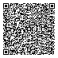

# MeshCore Sensor firmware — Seeed XIAO nRF52840 + Wio-SX1262

A ready-to-flash **MeshCore Sensor role** build for the
[Seeed XIAO nRF52840 + Wio-SX1262 kit](https://wiki.seeedstudio.com/xiao_nrf52840&_wio_SX1262_kit_for_meshtastic/).
Upstream MeshCore publishes no Sensor firmware for this board. This repo provides one,
with a **guest (read-only) login** added so a sensor can be shared for testing without giving away admin.

Built from MeshCore **v1.17.1** (upstream commit `a366955c`) plus the patch in [`patches/`](patches/).

## What you get

| | |
|---|---|
| Role | Sensor (pull-based: answers telemetry requests, does not beacon readings) |
| Sensors | Any supported I²C part, auto-detected at boot: BME280, BMP280, BME680, AHT10/20, SHT4x, SHTC3, LPS22HB, INA219/226/260/3221, MLX90614, VL53L0X, BMP085 |
| I²C pins | **SDA = D7, SCL = D6** (MeshCore's pin map; this is the *reverse* of Meshtastic's `_i2c` build) |
| Radio default | PhillyMesh **MeshCore 500**: 919.5 MHz / 500 kHz / SF10 / CR 4/5 |
| Adverts | Flood advert every **12 h** by default (`flood.advert.interval`) |
| Admin password | `password`. **Change it** (see below) |
| Guest password | **Disabled** until you set one |

## Wiring

See [`docs/bmp280_xiao_wiring.pdf`](docs/bmp280_xiao_wiring.pdf) for a diagram. For a 6-pin BMP280/BME280 breakout:

| Sensor | XIAO / Wio-SX1262 pin |
|---|---|
| VCC | 3V3 (**not** VIN, which is 5 V) |
| GND | GND |
| SCL | **D6** |
| SDA | **D7** |
| CSB | 3V3 (selects I²C mode) |
| SDO | GND (address 0x76) |

Leave every other pin alone. They belong to the LoRa radio.

## Flashing

Download the files from the [latest release](../../releases/latest).

**Drag and drop (easiest):** plug the XIAO in by USB and **double-tap RESET**. A USB drive
(`XIAO-SENSE` / `XIAO-BOOT`) appears. Copy `xiao-nrf52840-sensor-*.uf2` onto it. The board reboots
into the new firmware. The stock Seeed bootloader (SoftDevice S140 7.3.0) is required, and boards
shipped for Meshtastic/MeshCore already have it.

**Serial DFU:** `adafruit-nrfutil dfu serial -pkg xiao-nrf52840-sensor-*.zip -p <port> -b 115200 --singlebank`

Check downloads against `SHA256SUMS`.

## First-time setup (USB serial, 115200 baud)

Any serial terminal works. Commands:

```
time <unix-epoch>          # set the clock (lost on every reflash/power loss without battery)
password <new-admin-pw>    # CHANGE THIS
set guest.password <pw>    # optional: enable read-only guest login
set name <node name>
set lat <decimal>          # set lat/lon so it shows on maps
set lon <decimal>
set path.hash.mode 1       # PhillyMesh uses 2-byte path hashes
set radio 919.5,500,10,5   # only if you need a different profile
advert                     # announce now
```

After that, you can also administer it over the mesh from the MeshCore app (log in with the admin password).

## Access levels

| Login with | You get |
|---|---|
| admin password | full control: telemetry, history, remote CLI (rename, retune, change passwords) |
| guest password | **read-only**: telemetry and min/max/avg history. Remote CLI commands are ignored |
| anything else | rejected |

An admin who later logs in with the guest password keeps admin rights. To grant read-only access to one
person without sharing any password, run `setperm <their-pubkey-hex> 1`.

## Try one: WB2MNF QTH Temp

A live test node near Philadelphia (temperature only):

- **Name:** `WB2MNF QTH Temp`
- **Public key:** `dacf24ddb2c4de3d6a19f617f6e7079a36ef0b63b24b66eec70d394097fc6afd`
- **Guest password:** `MNFguest`
- **Radio:** PhillyMesh MeshCore 500 (919.5 / 500 / SF10 / CR5)

If you haven't heard its advert, import it directly. In the MeshCore app, add a contact from this link or scan the QR code:

```
meshcore://1140dacf24ddb2c4de3d6a19f617f6e7079a36ef0b63b24b66eec70d394097fc6afda1bcc76ab2c8a32e43542ce9c6d3bed7a2eb5151715a57842e48663b991e271ea95dba7d732921855360cf6ddc08b13b1e7f4b9aa8a1ab261af475c9a4721bb50880ae0e948cf35f0208d685fb5742324d4e46205154482054656d70
```



Then log in with `MNFguest` and request telemetry. You need a radio path to it on the MeshCore 500 network.

## Building it yourself

```bash
git clone https://github.com/meshcore-dev/MeshCore.git
cd MeshCore
git checkout a366955cb2f67b8e6842d4f00d2b6a554dddd88a
git am /path/to/patches/0001-*.patch
pio run -e Xiao_nrf52_sensor
```

Build-time options (add to `build_flags`): `-D GUEST_PASSWORD='"..."'` sets a default guest password;
`-D FLOOD_ADVERT_INTERVAL=<hours>` sets the flood advert interval (0 = off); `-D TELEM_BMP280_TEMP_ONLY=1`
drops pressure/altitude from a BMP280 whose pressure channel is unreliable.

The env pins `toolchain-gccarmnoneeabi@1.120301.0` (GCC 12.3). The nRF52 platform's default
toolchain has no build for 64-bit ARM, and GCC 9.3 segfaults on Raspberry Pi 5 kernels with 16K pages.

## Known issues

- **UF2 drag-and-drop not yet verified on hardware.** The `.uf2` is built with the standard Adafruit `uf2conv`
  (family 0xADA52840), and the serial DFU `.zip` path is tested. Report back if the UF2 path misbehaves.
- Some cheap purple "GY-BMP280" boards read pressure far too low (one measured at ×0.77 of the true value).
  Temperature is fine. Use a genuine BME280 if you need pressure, and you also get humidity.
- The first telemetry request immediately after a login sometimes times out. A retry works.

## License

MIT. MeshCore is Copyright © 2025 Scott Powell / rippleradios.com. The modifications in this repo are
Copyright © 2026 Gloucester County Amateur Radio Club (W2MMD). See [LICENSE](LICENSE).
